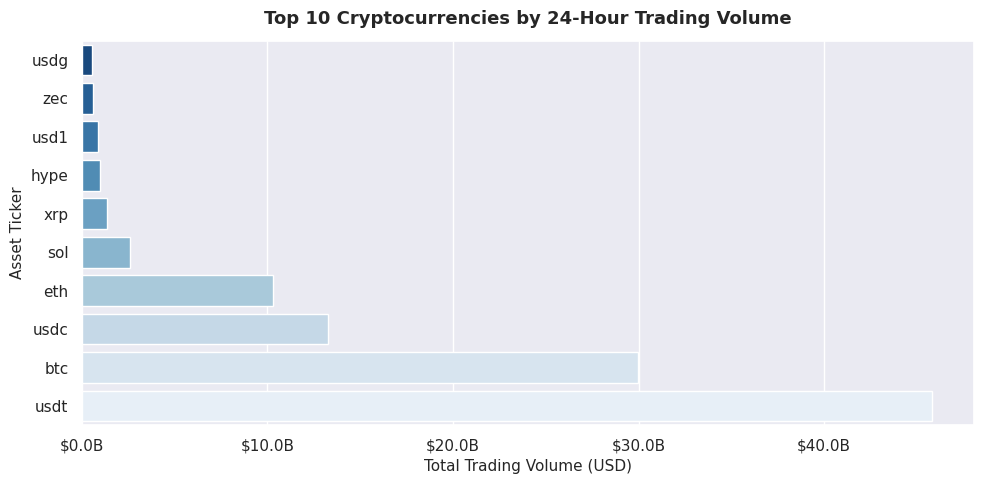
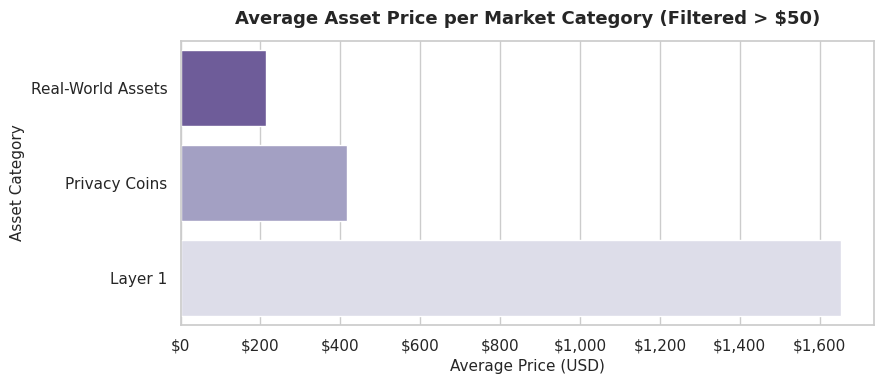
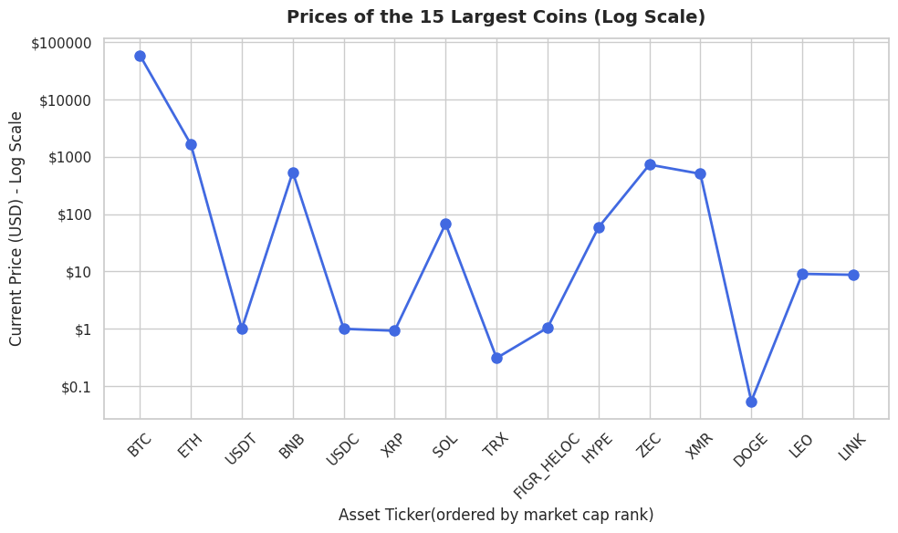

# Where Does the Money Sit in Crypto?
### Market Concentration & Liquidity Analysis with the CoinGecko API, SQL and Python


Crypto is often described as "a few giants and a long tail of small coins." This project tests that claim with data. I pulled live market data for the **top 250 cryptocurrencies** from the CoinGecko API, loaded it into a **SQLite database**, and used **SQL** (joins, aggregation, window functions, CTEs) and **Python** to measure how concentrated market value and trading activity really are.

---

## Key Findings

| Metric | Result |
|---|---|
| Share of total market cap held by the **top 10 coins** | **89.6%** |
| Share of 24h trading volume from the **10 most-traded coins** | **92.0%** |
| Coins mapped to a utility category | 210 of 250 |

1. **Value is extremely top-heavy.** Ten coins hold almost 90% of the market cap of the entire top 250. The other 240 share what's left.
2. **Liquidity is even more concentrated than value.** The 10 most-traded coins account for 92% of 24-hour volume, and four of them are stablecoins (USDT, USDC, USD1, USDG). Tether alone out-traded Bitcoin in this snapshot.
3. **High prices cluster in a few categories.** Only three categories average above $50 per token: Layer 1 (~$1,653), Privacy Coins (~$416) and Real-World Assets (~$213). Layer 1 is pulled up mostly by Bitcoin and Ethereum.

> Figures come from a single live snapshot (top 250 by market cap, USD). Re-running the notebook pulls fresh data, so exact numbers will shift. The overall pattern has held across runs.

---

## Visualizations

**Top 10 coins by 24-hour trading volume**
The steep drop after the top four shows how fast liquidity thins out below the market leaders.



**Average token price by category (categories averaging > $50)**



**Prices of the 15 largest coins (log scale)**
Bitcoin trades thousands of times higher than most coins, so a log scale keeps every coin visible on one chart. The stablecoins (USDT, USDC) sit flat at $1.



---

## Business Questions & SQL Techniques

| # | Business question | SQL techniques |
|---|---|---|
| 1 | How do prices and global rankings of tracked assets compare across utility categories? | `INNER JOIN`, `ORDER BY` |
| 2 | Which categories have an average token price above $50, and how many coins are in each? | `LEFT JOIN`, `COALESCE`, `GROUP BY`, `HAVING` |
| 3 | Which coins dominate market liquidity by 24h trading volume? | Window functions: `RANK()`, `DENSE_RANK()` |
| 4 | Which coins gained the most in the last 24 hours? | `WHERE ... IS NOT NULL`, `ORDER BY`, `LIMIT` |
| 5 | What share of market cap and volume do the top 10 coins hold? | CTE (`WITH`), `RANK()`, conditional aggregation (`SUM(CASE WHEN ...)`) |

Example: the concentration query behind the headline numbers.

```sql
WITH ranked AS (
    SELECT
        market_cap,
        total_volume,
        RANK() OVER (ORDER BY market_cap DESC)   AS cap_rank,
        RANK() OVER (ORDER BY total_volume DESC) AS volume_rank
    FROM crypto_market
)
SELECT
    ROUND(100.0 * SUM(CASE WHEN cap_rank <= 10 THEN market_cap END)
          / SUM(market_cap), 1) AS top10_market_cap_pct,
    ROUND(100.0 * SUM(CASE WHEN volume_rank <= 10 THEN total_volume END)
          / SUM(total_volume), 1) AS top10_volume_pct
FROM ranked;
```

---

## How It Works

```
CoinGecko API ──► pandas DataFrame ──► SQLite (crypto_project.db) ──► SQL queries ──► charts & insights
```

1. **Extract.** Request the top 250 coins by market cap from CoinGecko's `/coins/markets` endpoint (price, market cap, rank, 24h volume, 24h high/low, 24h % change).
2. **Clean.** Keep the relevant columns, drop rows missing market cap or volume, and stamp each row with the UTC time it was fetched.
3. **Load.** Write the data to a SQLite table, `crypto_market`, through SQLAlchemy.
4. **Enrich.** Pull coin lists for 8 CoinGecko categories (Stablecoins, Real-World Assets, Exchange Tokens, Privacy Coins, Meme Coins, AI, Layer 1, DeFi). Each coin gets the **first** category it matches, in priority order, so it's never counted twice. These go into a second table, `crypto_categories`. Requests retry with backoff on HTTP 429 rate limits.
5. **Analyze.** Run SQL queries against both tables with `pd.read_sql`.
6. **Visualize.** Plot the results with matplotlib and seaborn.

### Database schema

**`crypto_market`**: one row per coin

| Column | Description |
|---|---|
| `id`, `symbol`, `name` | CoinGecko identifiers |
| `current_price` | Price in USD |
| `market_cap`, `market_cap_rank` | Market capitalization and its rank |
| `total_volume` | 24-hour trading volume (USD) |
| `high_24h`, `low_24h` | 24-hour price range |
| `price_change_percentage_24h` | 24-hour % price change |
| `fetched_at` | UTC timestamp of the snapshot |

**`crypto_categories`**: `id`, `category` (joins to `crypto_market.id`)

---

## Tech Stack

- **Language:** Python
- **Data:** CoinGecko public API (free tier, no key required)
- **Libraries:** `requests`, `pandas`, `SQLAlchemy`, `matplotlib`, `seaborn`
- **Database:** SQLite
- **Environment:** Google Colab / Jupyter

---

## Run It Yourself

**Option 1: Google Colab (easiest)**
Open the notebook in Colab and choose **Runtime ▸ Run all**. Every library it uses is already installed in Colab.

**Option 2: Locally**

```bash
git clone https://github.com/floresthescientist/Crypto-Market-Concentration-Analysis-CoinGecko-API-SQL-Python.git
cd Crypto-Market-Concentration-Analysis-CoinGecko-API-SQL-Python
pip install requests pandas sqlalchemy matplotlib seaborn jupyter
jupyter notebook CoinGecko_SQL_Market_Analysis.ipynb
```

> **Note:** The category step pauses 15 seconds between requests to stay under CoinGecko's free-tier rate limit, so a full run takes about 2–3 minutes.

---

## Repository Structure

```
├── CoinGecko_SQL_Market_Analysis.ipynb   # Full analysis: extract, load, SQL, charts
├── images/                               # Charts used in this README
│   ├── volume_leaderboard.png
│   ├── avg_price_by_category.png
│   └── core_asset_prices_log.png
└── README.md
```

`crypto_project.db` is created when you run the notebook, so it isn't committed.

---

## Limitations & Next Steps

- **Point-in-time snapshot.** Results reflect one moment. Scheduling the pull daily would allow trend analysis, such as how concentration changes during rallies and sell-offs.
- **Category coverage.** 40 of the 250 coins don't fall into any of the 8 categories, and assigning one category per coin simplifies coins that span several sectors.
- **Volume quality.** Reported 24h volume can include wash trading on some exchanges, and several tokenized real-world assets report zero volume.
- **Ideas to extend:** a Herfindahl-Hirschman Index (HHI) for concentration, comparing results with and without stablecoins, and an interactive Tableau or Power BI dashboard.

---

## Author

**Adonis Flores**
B.S. Computer Information Systems, Lehman College (CUNY)
[GitHub](https://github.com/floresthescientist)

*Data provided by [CoinGecko](https://www.coingecko.com/en/api).*
